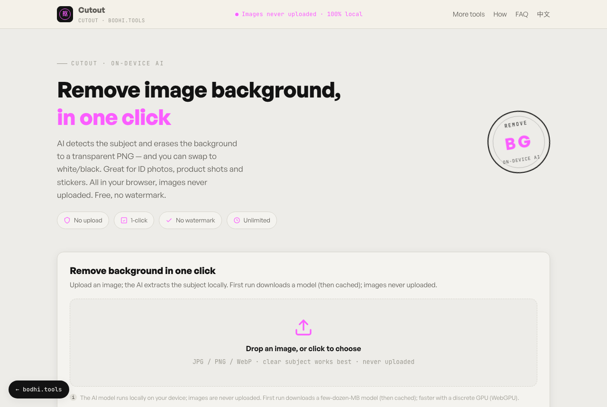

# Cutout: Remove Image Backgrounds

**English** · [简体中文](README.zh-CN.md)

Remove the background from a photo in your browser with an on-device AI model. Your image is never uploaded. Export a transparent PNG, or put the subject on a white or black background.

**Try it:** https://cutout.bodhi.tools/en/



## Features

- One-click background removal with the IS-Net model at its highest-quality setting
- Transparent, white or black background, previewed before you download
- PNG output
- Progress shown while the model downloads and while it runs
- No watermark, no signup, no usage limits
- English and Simplified Chinese interface

Works best on a clear subject against a simple background.

## How it works

[@imgly/background-removal](https://github.com/imgly/background-removal-js) runs an IS-Net segmentation model with ONNX Runtime Web (WebAssembly) in the browser. The first run downloads about 190 MB: the 176 MB `isnet` model plus the ONNX Runtime files. The browser caches them, so later runs start much faster.

To cut the download, change `model: 'isnet'` in `src/main.ts` to `'isnet_fp16'` (88 MB) or `'isnet_quint8'` (44 MB), at some cost in edge quality.

## Privacy

- Your image is read and processed in your browser. The app has no upload endpoint.
- The model and runtime files come from IMG.LY's CDN (`staticimgly.com`). You can self-host them by setting the library's `publicPath` option. Fonts load from Google Fonts and Fontshare.
- The hosted site at cutout.bodhi.tools uses Cloudflare Web Analytics, which counts page views without cookies. If you self-host and don't want it, delete the `cloudflareinsights` script tag in `index.html` and `en/index.html`.

## Run it locally

Requires Node.js 20.19+ (or 22.12+) and [pnpm](https://pnpm.io).

```bash
git clone https://github.com/bodhi1425/cutout.git
cd cutout
pnpm install
pnpm dev     # http://localhost:5173
pnpm build   # static site in dist/
```

`dist/` contains only static files. Host it on Cloudflare Pages, Netlify, GitHub Pages or any web server.

## Project layout

```
index.html       Chinese page (/)
en/index.html    English page (/en/)
src/main.ts      UI, background removal and export
src/style.css    Styles
public/          favicon, robots.txt, sitemap.xml
```

## Built with

| Package | Used for | License |
|---|---|---|
| [@imgly/background-removal](https://github.com/imgly/background-removal-js) | Background removal | AGPL-3.0 |
| [Vite](https://vite.dev), [TypeScript](https://www.typescriptlang.org) | Build | MIT, Apache-2.0 |

## License

This project is licensed under the [GNU Affero General Public License v3.0 or later](LICENSE), because it is built on @imgly/background-removal, which is AGPL-3.0. If you run a modified version as a public web service, the AGPL requires you to offer its source code to your users. IMG.LY sells a commercial license for the library if the AGPL doesn't suit your use.

© 2026 bodhi1425

## More privacy-first tools

Each one runs entirely in your browser:

- [local-pdf-toolbox](https://github.com/bodhi1425/local-pdf-toolbox): merge, split, compress and convert PDFs
- [image-compressor](https://github.com/bodhi1425/image-compressor): compress an image to an exact KB size
- [heic-converter](https://github.com/bodhi1425/heic-converter): convert iPhone HEIC photos to JPG or PNG
- [qrcode](https://github.com/bodhi1425/qrcode): QR codes with logos, gradients, Wi-Fi and vCard
- [ocr](https://github.com/bodhi1425/ocr): extract text from images

## Contributing

Bug reports and pull requests are welcome. Please open an issue first for larger changes. Contributions are accepted under the AGPL-3.0-or-later.
